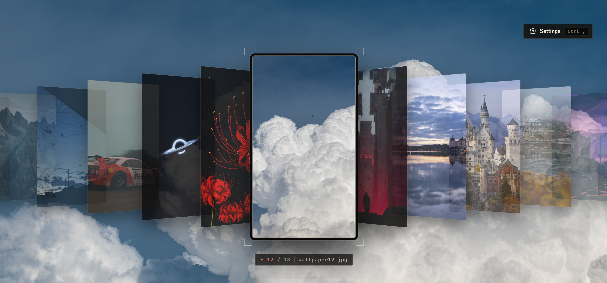

# Easy Paper

A lightweight, local-first, instant wallpaper selector for Windows, inspired by Linux Wayland setups (Hyprland / Quickshell). It floats seamlessly over your desktop with a transparent background, presents your wallpapers in a 3D perspective carousel, and applies your chosen wallpaper with a single click.



---

## Features

- **Instant Toggle via Global Shortcut**: Summon or dismiss the selector anytime from anywhere with a customizable hotkey (default: `Win + J`).
- **Linux Rice Aesthetic (Hyprland / Quickshell Style)**: Fully transparent frameless overlay spanning 100% screen width and 70% height, centered vertically.
- **Darkroom Theme**: A photographic-darkroom look across the app: warm carbon surfaces, a single red safelight accent, film-frame numbering, easel crop marks on the focused wallpaper and a contact-sheet layout for online results.
- **3D Perspective Carousel**: Smooth 3D coverflow carousel with depth, perspective rotation, and interactive navigation (mouse wheel, keyboard arrows, or clicking).
- **Vertical 9:16 Wallpapers**: Displays vertical cards with center-cropped thumbnails so more wallpapers fit across your screen simultaneously.
- **Multi-Monitor & Per-Monitor Support**: Automatically summons on the monitor where your cursor is currently located, applying the selected wallpaper exclusively to that monitor without altering other displays.
- **High-Performance Thumbnail Caching**: Automatically creates and caches sharp 450x800 Lanczos-filtered thumbnails in a local `.cache/thumbnails` folder, keeping resource usage minimal even with large 4K/8K wallpaper collections.
- **One-Click Native Wallpaper Switching**: Seamlessly updates your desktop background using Windows Shell COM APIs (`IDesktopWallpaper`) with automatic fallback to `SystemParametersInfoW`, with a short "developing print" animation as feedback.
- **Automatic Rotation**: Let the wallpaper change on its own, either every time Windows starts or on an interval (15 minutes to 24 hours, or a custom value from 5 minutes to 7 days). Choose **Shuffle** (every wallpaper before any repeats) or **Random**; each monitor gets a different image. Time the PC spends asleep counts toward the interval.
- **Original Wallpaper Backup**: On first run, the wallpaper you had before installing Easy Paper is copied into your wallpaper folder as `Original wallpaper.<ext>`, so you can always go back to it. It runs only once and never duplicates an image that is already in the folder.
- **Online Wallpaper Search**: From **Settings > Online Sources**, search and download straight into your folder from:
  - [Wallhaven](https://wallhaven.cc): works right away, filtering by sorting, aspect ratio and your screen resolution.
  - [Unsplash](https://unsplash.com) and [Pexels](https://www.pexels.com): use your own free API key (see [Online Sources](#online-sources)).
- **Transparent Taskbar (Windows 11)**: Removes the taskbar background so your wallpaper shows through, similar to TranslucentTB. Reverted when Easy Paper quits.
- **Update Notifications**: Checks GitHub Releases once when the app starts and shows a download link in the Settings sidebar when a new version is out. You can also check manually with **Check for updates**.
- **Starts with Windows**: Registers itself to launch at sign-in, so the shortcut and automatic rotation are always available.
- **System Tray Integration**: Resides discreetly in the Windows system tray / notification area with options to add pictures, open settings, reload the shortcut, or quit.

---

## How It Works

1. **Summon**: Press your shortcut (default `Win + J`) or left-click the tray icon. The selector smoothly appears on top of your windows on the monitor where your cursor is positioned.
2. **Browse**:
   - Scroll horizontally or vertically with your **mouse wheel**.
   - Navigate using **`Left Arrow` (`←`)** and **`Right Arrow` (`→`)**.
   - Click directly on any visible side card to focus it.
3. **Apply**: Click the active card or press `Enter` / `Space`. The print "develops" under the safelight, your Windows wallpaper changes instantly on that monitor, and the selector dismisses itself.
4. **Dismiss**: Click outside the window or press the global shortcut again to hide it at any time.

---

## Configuration

Most options are available in the **Settings** window: right-click the Easy Paper icon in the system tray and select **"Settings"**, or press `Ctrl + ,` while the carousel is open.

Everything is saved in a `config.json` file on your machine:

```text
%AppData%\easy-paper\config.json
```
*(Full path: `C:\Users\<YourUsername>\AppData\Roaming\easy-paper\config.json`)*

### Configuration Structure

<!-- The "super" shortcut means Windows key -->

```json
{
  "shortcut": "super+j",
  "images_path": "C:\\Users\\your_user\\Pictures\\Easy paper",
  "taskbar_transparent": false,
  "auto_rotate": {
    "enabled": false,
    "trigger": "interval",
    "interval_minutes": 180,
    "order": "shuffle"
  },
  "original_wallpaper_saved": true
}
```

### Options

| Parameter | Type | Default | Description |
| :--- | :--- | :--- | :--- |
| `shortcut` | `string` | `"super+j"` | Global hotkey combination to toggle the window (e.g. `alt+space`, `ctrl+shift+p`, `super+w`). |
| `images_path` | `string` | `Pictures\Easy paper` | Absolute path to the folder containing your wallpapers (`.png`, `.jpg`, `.jpeg`, `.webp`, `.bmp`). |
| `taskbar_transparent` | `boolean` | `false` | Makes the Windows 11 taskbar transparent. Toggle it from **Settings > Taskbar**. |
| `auto_rotate.enabled` | `boolean` | `false` | Turns automatic rotation on. Configure it from **Settings > Wallpapers**. |
| `auto_rotate.trigger` | `string` | `"interval"` | `"interval"` to change every `interval_minutes`, or `"on_startup"` to change once each time Windows starts. |
| `auto_rotate.interval_minutes` | `number` | `180` | Minutes between changes, from `5` to `10080` (7 days). |
| `auto_rotate.order` | `string` | `"shuffle"` | `"shuffle"` shows every wallpaper before repeating any; `"random"` picks any wallpaper each time. |
| `original_wallpaper_saved` | `boolean` | `false` | Set automatically after the first-run backup of your original wallpaper. Set it back to `false` to run the backup again on the next start. |

> **Tip**: After editing `config.json` by hand, right-click the tray icon and select **"Reload Shortcut"** to apply a new shortcut without restarting the application.

### Online Sources

Wallhaven needs no setup. Unsplash and Pexels require a free personal API key, which each user creates for themselves:

1. Open **Settings > Online Sources** and select the **Unsplash** or **Pexels** tab.
2. Click **Get a free key** and follow the steps shown (create an app on Unsplash, or request a key on Pexels).
3. Paste the key and click **Verify & Save**. Easy Paper tests it with one request before saving.

API keys are **not** stored in `config.json`. They are kept in **Windows Credential Manager** and are only sent to their provider. You can change or remove a key at any time from the bottom of each source tab.

Free limits: Unsplash demo keys allow 50 requests per hour, and Pexels allows 200 requests per hour.

---

## Development & Building

### Prerequisites

- [Node.js](https://nodejs.org/) (v18+ recommended)
- [Rust](https://www.rust-lang.org/tools/install) (latest stable or 2024 edition)
- C++ Build Tools (via Visual Studio Installer with the "Desktop development with C++" workload)

### Getting Started

1. **Clone the repository**:
   ```bash
   git clone https://github.com/LucasOSantana/easy-paper.git
   cd easy-paper
   ```

2. **Install frontend dependencies**:
   ```bash
   npm install
   ```

3. **Run in development mode**:
   ```bash
   npm run tauri dev
   ```

4. **Build for release**:
   ```bash
   npm run tauri build
   ```
   The installer will be located in `src-tauri/target/release/bundle/msi/`.

5. **Run the tests**:
   ```bash
   cd src-tauri
   cargo test --lib
   ```

### Releasing

The in-app update check reads the **latest** release of this repository from the GitHub API, so every release must follow these steps:

1. Update the version in all three files, keeping them identical:
   - `package.json`
   - `src-tauri/tauri.conf.json` (the version the app reports and compares)
   - `src-tauri/Cargo.toml`
2. Build the installer with `npm run tauri build`.
3. Create a GitHub release with the tag `vX.Y.Z` (for example `v1.3.0`), mark it as the latest release, and attach the `.msi` installer.

Drafts and pre-releases are ignored by the update check, so a version can be published as a pre-release for testing without notifying users.

### App Icon

All icon sizes are generated from `src-tauri/icons/icon-source.svg`:

```bash
npx tauri icon src-tauri/icons/icon-source.svg
cd src-tauri && cargo clean -p easy-paper
```

The `cargo clean` step is needed because Cargo does not notice icon changes and would keep embedding the old icon in the executable.

### Taskbar Component (`src-tauri/taskbar-tap`)

A DLL loaded into `explorer.exe` through `InitializeXamlDiagnosticsEx` (like TranslucentTB) that hides the taskbar background. It is built by `npm run build:tap`, which `tauri dev` / `tauri build` run first. Changes to the DLL only take effect after restarting Explorer.

---

## Tech Stack

- **Framework**: [Tauri v2](https://v2.tauri.app/)
- **Backend**: Rust (XAML diagnostics DLL for the taskbar, Windows Shell `IDesktopWallpaper` COM API & Win32 API, multi-monitor cursor tracking, `image` crate with Lanczos3 filtering, global hotkeys, system tray, `ureq` for Wallhaven / Unsplash / Pexels / GitHub requests, `keyring` for Windows Credential Manager)
- **Frontend**: React 19, TypeScript, Vite
- **Styling**: Pure CSS with darkroom design tokens (`src/styles/darkroom.css`) and CSS 3D transforms (`perspective`, `transform-style: preserve-3d`)
